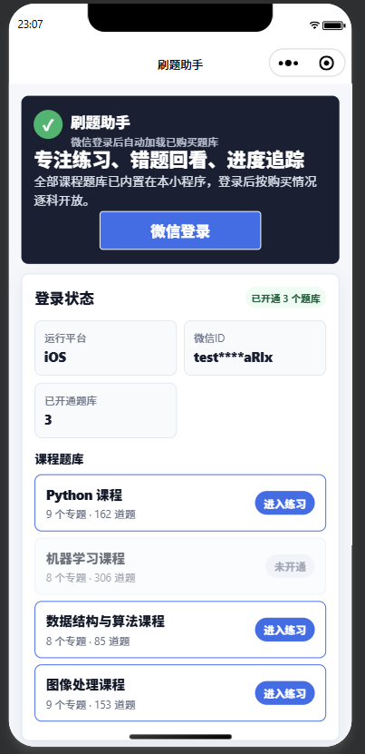

# 刷题助手

tutti 是可扩展的刷题助手，提供网页端和微信小程序。两边共用同一份题库与同一套专题划分，但**登录体系与数据不互通**：小程序按微信 openid + 后台授权，网页版按账号密码，答题记录分别存在微信云数据库和网页服务端。

- 想改代码、看接口与数据结构 → [docs/development.md](docs/development.md)
- 只想部署和用 → 继续往下看

## 主要功能

- 界面
  - [x] 答题进度
- 练习
  - [x] 试卷练习（固定 20 单选 + 10 判断 + 10 填空）
  - [x] 专题练习 / 随机练习（单选、判断、填空三种题型）
  - [x] 题量可选（1 / 10 / 20 / 30 题）
  - [x] 答完显示本次成绩（答对题数与正确率）
  - [ ] 真题练习（入口已占位，待接入真题题库）
- 题库
  - [x] 按专题分类
  - [x] 随机抽取
  - [x] 打乱选项顺序
  - [x] 答案解析
  - [x] 按试卷模板出题
- 统计
  - [x] 错题本
  - [x] 错题带解析、同一题只记一条、可单条移除
- 作业
  - [x] 上传作业并按上传规则校验（网页版在服务端校验，小程序端直传云存储）
  - [x] 查看上传记录并逐条删除（删自己的；网页版管理员可删任意一条）
- 自定义内容
  - [x] 题库预导入
- 登录
  - [x] 微信登录（小程序端，不提供账号密码等其他方式）
  - [x] 账号密码登录（网页端，自建账号表）
  - [x] 刷新授权与退出登录（小程序端）
- 导出
  - [x] 导出试卷
  - [x] 导出错题本
- 授权
  - [x] 根据后台购买结果加载题库
  - [x] 全部课程内置同一小程序
    - 已购课程可选
    - 未购课程不可选

### 已支持课程

- [x] `py`：Python 编程
- [x] `al`：数据结构与算法
- [x] `ml`：机器学习
- [x] `cv`：图像处理
- [ ] `dl`：深度学习

全部课程题库都编译进同一个小程序，未开通的课程置灰不可进入。新增课程要同步改哪三处，见 [docs/development.md](docs/development.md) 的「新增一门课程」。



## 使用说明

### 学员

**网页版**：打开网址 → 用管理员给的账号密码登录 → 首页列出全部题库，已开通的可点进入，未开通显示「未开通」（点一下会提示去联系管理员）→ 选专题（或「全部专题（混合）」）→ 选题量与题型 → 开始练习 → 逐题作答，提交后立刻显示对错与解析（填空需手输答案）→ 答完显示正确率。当前视图与选择都会写进地址栏（`?view=quiz&course=py&topic=var&count=20&type=all`），刷新不掉进度页、可以分享链接、也能用浏览器后退。

**微信小程序**：微信中打开小程序，自动完成微信登录 → 首页列出全部课程，已购课程显示「进入练习」，未开通的点一下会提示联系管理员（管理员开通后点首页「刷新授权」即可进入，不必卸载重进；「退出登录」会清掉本机缓存的登录状态）→ 进入答题页后先选题量（1 / 10 / 20 / 30 题，作用于「专题」「随机」两类练习）与练习方式（试卷练习〔固定 20 单选 + 10 判断 + 10 填空〕/ 真题练习〔入口占位〕/ 专题单选 / 专题判断 / 专题填空 / 随机单选 / 随机判断 / 随机填空），只有「专题」开头的三种会显示专题按钮，再挑专题出题 → 逐题作答，提交后立刻显示对错与解析（填空需手输答案），点「下一题」继续，最后一题按钮变成「查看成绩」，给出本次答对题数与正确率 → 统计、专题进度、错题本按课程分开保存，同一道题重复答错只记一条。「错题本」可逐条查看解析并单条移除；「导出错题本」会生成带解析的 Markdown `.txt` 并唤起发送面板，选「文件传输助手」即可存进自己的微信；「导出试卷」把当前练习队列复制到剪贴板；「重置」需二次确认后才会清空该课程的统计与错题。

**微信小程序（作业上传）**：管理员开着作业上传时，课程卡片上会多一个「上传作业」入口。小程序的沙箱读不到手机文件系统，所以文件**只能从聊天记录里选**：先把作业发给「文件传输助手」，进来点「选择文件并上传」选中它即可。规则不符时弹窗会说清原因（哪种格式不允许、文件名该怎么写）；上传成功后下面列出自己的记录，逐条可以删除（删的是云存储里的文件，删掉就得重传）。

### 管理员

1. 用 `admin` 账号登录网页版，**全部题库自动解锁**（普通账号只能进已登记的课程）。
2. **开通课程**：`node scripts/manage-accounts.cjs courses <账号> py,ml` 调整该账号的已购课程（完整 CLI 见 [docs/development.md](docs/development.md) 的「账号管理」）。
3. **上传规则**：课程页底部「上传规则设置」面板改允许格式、文件名正则、命名说明、大小上限，保存后对所有学员的后续上传立即生效。格式与命名的校验在服务端，改前端绕不过。注意**这套规则只管网页端**：小程序读不到服务端的规则文件，用的是 `services/upload-rules.ts` 里同值的默认副本，要让小程序也改，得改那份代码再重新发布。
4. **学员作业**：网页版在课程页「作业上传」面板里看，管理员可删任意一条（`DELETE /api/uploads/<记录 id>`）。**小程序的作业是另一套**：文件在微信云存储、记录在云数据库集合 `homework_uploads`，要在云开发控制台查看与清理；两边的上传互不可见。
5. 小程序的课程开通走云开发那一套：在云开发控制台的 `user_profiles` 里把该用户文档的 `agents.<课程>` 改成 `true`，学员在首页点「刷新授权」后生效（不必卸载重进；点「退出登录」再重新登录也一样，不需要在网页端操作）。

## 文档与目录

| 路径                                       | 内容                                                                                                                                                                                                                     |
| ------------------------------------------ | ------------------------------------------------------------------------------------------------------------------------------------------------------------------------------------------------------------------------ |
| [docs/development.md](docs/development.md) | 开发文档：项目架构、题库与答题引擎、网页版实现（权限模型 / 会话与运行数据 / 上传规则 / 接口表）、小程序作业上传、已知限制、账号管理、部署清单（网页版 / 小程序）、微信登录授权契约、`user_profiles` 结构、本地调试与测试、试卷生成流水线 |
| [docs/design.md](docs/design.md)           | 试卷智能体设计与 Word 导出格式要求                                                                                                                                                                                       |
| `templates/`                               | 试卷模板与配置：`exam-template.md`、`examif.json`、`export.json`、`export-schema.json`、`latex-replace.json`                                                                                                            |
| `outputs/`                                 | 试卷脚本的生成物（`.md` / `.docx`）                                                                                                                                                                                      |

```text
├── cloudfunctions/ # 云函数：login（取 openid + 返回课程开通）
├── data/       # 题库 data/topic-*.ts、本地测试开关、网页端账号表
├── docs/       # development.md、design.md
├── outputs/    # 试卷脚本的生成物
├── pages/      # 小程序页面
├── prompts/    # 课程知识点提示
├── scripts/    # 构建、账号、自检、组卷脚本
├── services/   # 核心业务逻辑
├── templates/  # 试卷模板与配置
├── types/      # TypeScript 类型定义
└── web/        # 网页版（Node 服务端 + 静态页面）
```

## 部署与运行

两条发布通道共用 `data/topic-*.ts` 这一份题库，可只上一边，也可两边都上。

> **运行环境**：Node ≥ 22.6.0（`web/package.json` 的 `engines` 已声明，用系统里装好的 Node 即可；项目零依赖，不需要 `npm install`）。小程序端由微信开发者工具编译，不受这个限制。

| 通道       | 入口       | 登录方式               | 运行形态               |
| ---------- | ---------- | ---------------------- | ---------------------- |
| 网页版     | `web/`     | 账号密码（自建账号表） | Node HTTP 服务，单端口 |
| 微信小程序 | 仓库根目录 | 微信登录 + 后台授权    | 微信开发者工具上传发布 |

### 网页版部署

网页版就是仓库里的一个 Node 服务：**没有构建步骤，也没有需要同步的副本**。题库（`data/topic-*.ts`）与账号表（`data/accounts.json`）都是运行期直接读的，改完重启服务即生效。

```bash
# 1) 初始化账号（仅首次；密码随机生成并只打印一次）
node scripts/manage-accounts.cjs init

# 2) 启动（无第三方依赖，不需要 npm install）
PORT=3000 HOST=0.0.0.0 node web/server.js
# 有持久化目录的机器上，让它把会话/规则/作业都落到那里，别留在随代码更新的 web/data：
# TUTTI_DATA_DIR=/var/lib/tutti PORT=3000 HOST=0.0.0.0 node web/server.js

# 3) 启动前先自检一次（账号表、默认密码、会话落盘、运行数据目录）
node scripts/web-deploy-check.cjs
```

- **运行形态**：任何能跑 Node 的主机起这一个进程即可，前面挂 Nginx 做 HTTPS 与反向代理。服务默认监听 `PORT` 并绑定 `0.0.0.0`。
- **`web/` 与 `data/` 要在一起**：服务运行期读的是 `../data/topic-*.ts` 与 `../data/accounts.json`，所以部署时带上整个仓库，或至少保持这两个目录的相对位置。
- **运行期环境变量**：除 `PORT` / `HOST` 外还有三个与数据落盘相关的变量。

  | 变量                  | 默认值                      | 作用                                           |
  | --------------------- | --------------------------- | ---------------------------------------------- |
  | `TUTTI_DATA_DIR`      | `web/data`                  | 运行数据目录：会话、上传规则、学员作业都落这里 |
  | `TUTTI_SESSION_STORE` | `file`                      | `file` 落盘（重启不掉线）/ `memory` 纯进程内存 |
  | `TUTTI_SESSION_DIR`   | `<TUTTI_DATA_DIR>/sessions` | 单独指定会话目录，一般不用改                   |

  默认的 `web/data` 就在应用目录里，更新代码时容易被一并覆盖。想长期保留登录态、上传规则与学员作业，就把它指到应用目录之外，之后用 `GET /api/health` 的 `dataDirBoots` / `dataDirFirstBootAt` 复核（重启后 `boots` 继续累加、`firstBootAt` 不变即为正常）：

  ```bash
  TUTTI_DATA_DIR=/var/lib/tutti PORT=3000 HOST=0.0.0.0 node web/server.js
  node scripts/web-deploy-check.cjs
  ```

**部署清单**：启动前逐项过一遍 → [docs/development.md 的「部署清单」](docs/development.md#部署清单)（`node scripts/web-deploy-check.cjs` 自检，退出码非 0 即还有未通过项）。

**更新与回滚**：拉代码后重启服务即生效（改题库、改账号、改上传规则都是这样）；代码回滚就切回旧版本再重启。动手前先备份 `data/accounts.json` 与整个 `TUTTI_DATA_DIR`。

### 小程序部署

1. 用**微信开发者工具**（稳定版）导入仓库根目录；`project.config.json` 里的 `appid` 目前是 `wxf7f1812c7c4f4106`，换成自己的需在微信公众平台注册后修改该字段。
2. **本地调试**：把 `data/access.ts` 里要测的课程置为 `true`，开发者工具扫码登录即可进入（详见 [docs/development.md](docs/development.md) 的「扫码测试登录」）。
3. **登录云函数**：仓库已带 `cloudfunctions/login`——它用 `cloud.getWXContext()` 直接取 openid，**不需要自建后台、不需要 AppSecret 与备案域名**。开发者工具里右键 `cloudfunctions/login` →「上传并部署：云端安装依赖」即可；函数名在 `services/runtime-config.ts` 的 `loginFunctionName`（默认 `login`）。没上传或云环境没建好时，首页会直接显示失败原因，不会白屏。
4. **云数据库**：开发者工具「云开发」新建/选择环境，建集合 `user_profiles`，权限建议「仅创建者可读写」。默认环境即可（多环境时在 `services/runtime-config.ts` 填 `cloudEnv` 指定环境 ID，留空时启动会 `console.warn` 提示）。**开通课程**：在云开发控制台把该学员文档的 `agents.<课程>` 改成 `true`，学员重新登录后生效。云数据库读写失败时答题页会降级为本地使用并弹 toast，不会白屏。
5. **作业上传（可选）**：生产配置里 `enableHomeworkUpload` 默认开着，课程卡片会出现「上传作业」入口。用它还要在云开发控制台另建集合 `homework_uploads`（权限同样「仅创建者可读写」），云存储权限保持默认的「所有用户可读、仅创建者可写」；没建集合时上传会失败并给出云开发的报错，不影响答题。不想用就把 `enableHomeworkUpload` 改成 `false` 重新发布，入口不再出现。
6. **发布**：开发者工具右上角「上传」填版本号 → 微信公众平台「版本管理」提交审核 → 审核通过点「发布」。体验版（`envVersion=trial`）与正式版走同一套生产配置，可先拿它做真机验证。

**发布前自检**：逐项过一遍 → [docs/development.md 的「部署清单」](docs/development.md#部署清单)（`node scripts/miniprogram-release-check.cjs` 自检，退出码非 0 即还有未通过项；`[手工]` 项脚本判不了，需人工确认）。
