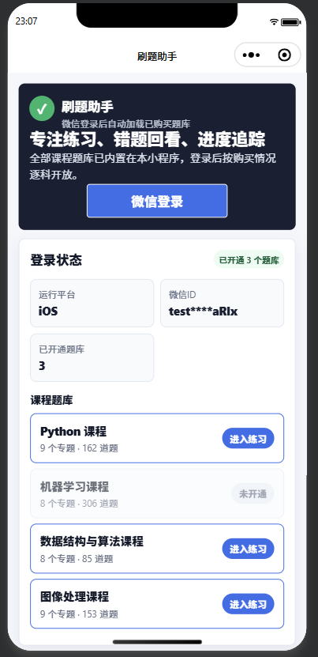

# 刷题助手

tutti 是可扩展的刷题助手，提供网页端和微信小程序。两边共用同一份题库与同一套专题划分，但**登录体系与数据不互通**：小程序按微信 openid + 后台授权，网页版按账号密码，答题记录分别存在微信云数据库和网页服务端。

- 想改代码、看接口与数据结构 → [docs/development.md](docs/development.md)
- 只想部署和用 → 继续往下看

## 主要功能

- 界面
  - [x] 答题进度
- 练习
  - [x] 试卷练习（固定 20 单选 + 10 判断 + 10 填空）
  - [x] 专题练习 / 随机练习（单选、判断、填空三种题型）
  - [x] 题量可选（1 / 10 / 20 / 30 题）
  - [x] 答完显示本次成绩（答对题数与正确率）
  - [ ] 真题练习（入口已占位，待接入真题题库）
- 题库
  - [x] 按专题分类
  - [x] 随机抽取
  - [x] 打乱选项顺序
  - [x] 答案解析
  - [x] 按试卷模板出题
- 统计
  - [x] 错题本
  - [x] 错题带解析、同一题只记一条、可单条移除
- 作业
  - [x] 上传作业并按上传规则校验（网页版在服务端校验，小程序端直传云存储）
  - [x] 查看上传记录并逐条删除（删自己的；网页版管理员可删任意一条）
- 自定义内容
  - [x] 题库预导入
- 登录
  - [x] 微信登录（小程序端，不提供账号密码等其他方式）
  - [x] 账号密码登录（网页端，自建账号表）
  - [x] 刷新授权与退出登录（小程序端）
- 导出
  - [x] 导出试卷
  - [x] 导出错题本
- 授权
  - [x] 根据后台购买结果加载题库
  - [x] 全部课程内置同一小程序
    - 已购课程可选
    - 未购课程不可选

### 已支持课程

- [x] `py`：Python 编程
- [x] `al`：数据结构与算法
- [x] `ml`：机器学习
- [x] `cv`：图像处理
- [ ] `dl`：深度学习

全部课程题库都编译进同一个小程序，未开通的课程置灰不可进入。新增课程要同步改哪三处，见 [docs/development.md](docs/development.md) 的「新增一门课程」。



## 使用说明

### 学员

**网页版**：打开网址 → 用管理员给的账号密码登录 → 首页列出全部题库，已开通的可点进入，未开通显示「未开通」（点一下会提示去联系管理员）→ 选专题（或「全部专题（混合）」）→ 选题量与题型 → 开始练习 → 逐题作答，提交后立刻显示对错与解析（填空需手输答案）→ 答完显示正确率。当前视图与选择都会写进地址栏（`?view=quiz&course=py&topic=var&count=20&type=all`），刷新不掉进度页、可以分享链接、也能用浏览器后退。

**微信小程序**：微信中打开小程序，自动完成微信登录 → 首页列出全部课程，已购课程显示「进入练习」，未开通的点一下会提示联系管理员（管理员开通后点首页「刷新授权」即可进入，不必卸载重进；「退出登录」会清掉本机缓存的登录状态）→ 进入答题页后先选题量（1 / 10 / 20 / 30 题，作用于「专题」「随机」两类练习）与练习方式（试卷练习〔固定 20 单选 + 10 判断 + 10 填空〕/ 真题练习〔入口占位〕/ 专题单选 / 专题判断 / 专题填空 / 随机单选 / 随机判断 / 随机填空），只有「专题」开头的三种会显示专题按钮，再挑专题出题 → 逐题作答，提交后立刻显示对错与解析（填空需手输答案），点「下一题」继续，最后一题按钮变成「查看成绩」，给出本次答对题数与正确率 → 统计、专题进度、错题本按课程分开保存，同一道题重复答错只记一条。「错题本」可逐条查看解析并单条移除；「导出错题本」会生成带解析的 Markdown `.txt` 并唤起发送面板，选「文件传输助手」即可存进自己的微信；「导出试卷」把当前练习队列复制到剪贴板；「重置」需二次确认后才会清空该课程的统计与错题。

**微信小程序（作业上传）**：管理员开着作业上传时，课程卡片上会多一个「上传作业」入口。小程序的沙箱读不到手机文件系统，所以文件**只能从聊天记录里选**：先把作业发给「文件传输助手」，进来点「选择文件并上传」选中它即可。规则不符时弹窗会说清原因（哪种格式不允许、文件名该怎么写）；上传成功后下面列出自己的记录，逐条可以删除（删的是云存储里的文件，删掉就得重传）。

### 核心技术实现

- **题库加载**：`data/topic-*.ts` 按课程存储题库，格式符合 `QuizBank` 接口
- **答题引擎**：`services/quiz-engine.ts` 提供题目抽取、洗牌、选项随机化等核心功能
- **页面渲染**：`pages/quiz/` 负责小程序端的题目展示和交互
- **题型支持**：单选题、判断题、填空题

## 微信登录授权接口

授权入口在 `services/purchase.ts`。后台接口返回格式：

```json
{
  "openId": "用户微信 openid",
  "agents": {
    "py": true,
    "ml": false
  }
}
```

小程序会先调用 `wx.login` 获取 `code`，再向后台发送：

```json
{
  "code": "微信登录临时凭证"
}
```

`openId` 也可命名为 `wechatOpenId`。`agents` 的 key 是智能体 ID，value 表示是否已购买。生产环境默认值为全 `false`，本地测试环境会读取 `data/access.ts` 作为覆盖。购买后后台返回对应 key 为 `true`。没有登录、没有授权或接口未配置时，用户界面保持空白。

## 用户数据库

数据库入口在 `services/user-db.ts`，使用微信云数据库集合 `user_profiles`。每个微信用户一条记录，按 `wechatOpenId` 查询和更新。

记录结构：

```json
{
  "wechatOpenId": "用户微信 openid",
  "agents": {
    "py": true,
    "ml": false
  },
  "wrongQuestions": [],
  "stats": {
    "py": {
      "rightNum": 0,
      "wrongNum": 0,
      "totalNum": 0
    }
  },
  "progress": {
    "py": {
      "topicDone": {
        "var": 0
      }
    }
  },
  "createdAt": 0,
  "updatedAt": 0
}
```

保存内容包括微信 ID、题库购买情况、错题记录、答题统计和答题进度。答题和重置时会自动同步当前刷题助手的数据。

新增智能体时，需要同步增加：

- `data/access.json` 中的默认开关
- 对应题库文件
- `services/registry.ts` 中的智能体注册表

> 参考示例：数据结构与算法智能体 `al` 与图像处理智能体 `cv` 均已完整接入——题库分别在 `data/topic-al.ts`、`data/topic-cv.ts`，注册见 `services/registry.ts` 的 `AGENT_REGISTRY`，本地测试开关见 `data/access.ts`（开发环境置 `true` 即可扫码进入）。

## 扫码测试登录

当前 `services/purchase.ts` 支持本地扫码测试模式：当 `services/runtime-config.ts` 选择开发配置时，小程序仍会调用 `wx.login()`，开发者工具扫码登录后会生成本地测试 openid。

测试授权读取 `data/access.ts`，例如：

```ts
const access: Record<string, boolean> = {
  py: true,
  ml: false
};
```

将某个智能体改为 `true` 后，扫码登录即可进入对应题库。接入真实后端时，修改 `services/runtime-config.ts` 里的生产配置，填入真实后台地址和云数据库设置，后端用 `code` 换取真实 openid 并返回 `agents` 授权即可。
